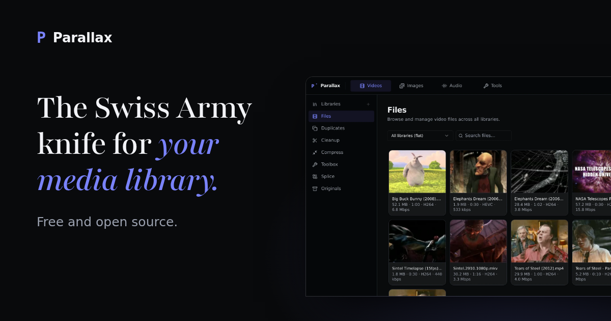

# Parallax

**The Swiss Army knife for your media library.** Parallax is a free, open source toolkit that sits alongside your media player and looks after the files behind it. It runs in Docker on your own machine and you use it from a web browser.



**[Documentation](https://parallax.raslan.dev/docs)** · **[Website](https://parallax.raslan.dev)** · [Changelog](CHANGELOG.md)

## What it does

- **Compress** videos and music so they take up much less space, with no quality loss you would notice. It uses your graphics card when it has one.
- **Find duplicates** of the same video, photo or song, even under different names, and keep the best one.
- **Clean up** a library by filtering for the files that match rules you set, like very short, tiny or old, and clearing them out together.
- **Identify** badly named files and rename them so Plex, Jellyfin and Kodi recognise them, with artwork and metadata for shows that are not on TMDB.
- **Organize** any folder by hand: see what is in it, group the files, then move, rename or delete them.
- **Fix problem files**: trim the ends, even out the volume, fix one-sided sound, turn a sideways clip upright, or splice several videos into one.
- **Find subtitles** for the videos that have none, and re-time the ones that are out of sync.
- **Upscale** pictures and **review** a collection for images you may not want in it.
- **Keep the originals.** Every change keeps a backup first, so you can put anything back with one click.

It also has a Home page that shows how much space it has saved you, a built-in player, a command palette (⌘K or Ctrl+K), and sixteen colour themes. Every feature has its own page in the [documentation](https://parallax.raslan.dev/docs).

## Install

Make a folder, save this as `docker-compose.yml` inside it, and run `docker compose up -d`:

```yaml
services:
  parallax:
    image: ghcr.io/raslan/parallax:latest
    container_name: parallax
    ports:
      - "7899:7899"
    volumes:
      - ./data:/app/data # Parallax's own database and thumbnails
      - /mnt/media:/media # your media; add as many mounts as you like
    environment:
      - DATA_DIR=/app/data
    user: "1000:1000" # match your host user; run `id` to check
    restart: unless-stopped
```

Then open [http://localhost:7899](http://localhost:7899). The first visit asks you to create the one admin account, so open it before you share the address. Parallax needs write access to your media folders, because it saves backups, compressed copies and subtitles next to your files.

- **Another port:** change the left number of the `ports` line, for example `"8080:7899"`.
- **Windows:** install [Docker Desktop](https://www.docker.com/products/docker-desktop/) first and leave it running.
- **Graphics card:** add your GPU to the service for faster compression. Parallax works without one, just more slowly. The steps for NVIDIA and AMD are in [Hardware acceleration](https://parallax.raslan.dev/docs/advanced/hardware-acceleration).
- **Versions:** `latest` is the newest release. A version such as `4.0` stays on that line and picks up small fixes. `nightly` is unfinished work from `develop` and can be broken, so keep it away from a library you care about.

More detail, including your first scan, is in the [install guide](https://parallax.raslan.dev/docs/getting-started/install).

## Build from source

```bash
git clone https://github.com/raslan/parallax.git
cd parallax
docker build -t parallax .
```

Use `parallax` in place of the `ghcr.io/...` image in the compose file above. When you iterate locally, always run `docker compose up --build`: a plain restart will not pick up your changes.

## Local development

To run the code and its tests outside Docker, you need these installed on your machine. How you install them depends on your system.

**Programs** (the backend runs them, and its tests run them for real):

- **Python 3.12** and **Node.js 20**, matching the Docker image.
- **ffmpeg** with its companion **ffprobe**, built with chromaprint (the Docker image uses jellyfin-ffmpeg).
- **ExifTool**, which reads and writes the tags inside images.
- **MKVToolNix** (its `mkvpropedit` tool), which edits tags in mkv and webm files.

**Python packages** are listed in `backend/requirements.txt` (the app) and `backend/requirements-dev.txt` (pytest and ruff). They include `mutagen` for music tags and `ncnn` for upscaling. A virtual environment keeps them out of your system Python:

```bash
cd backend
python3.12 -m venv .venv
.venv/bin/pip install -r requirements.txt -r requirements-dev.txt
.venv/bin/python -m pytest tests -q
```

**Frontend**: `npm install` in `frontend/`, then `npm run dev` for the dev server (it proxies `/api` to a backend on port 7899), `npm test` for the tests, and `npm run lint` for lint.

A test that needs one of the programs above fails or is skipped when it is missing, so install all of them for a clean run.

## Built with

Python and FastAPI on the back, React and Tailwind on the front, ffmpeg underneath, all in one Docker image. Credits for every project and licence Parallax builds on are in the app under Settings, then Credits.

## Licence

Parallax is free and open source, released under the [GPL-3.0](LICENSE).
